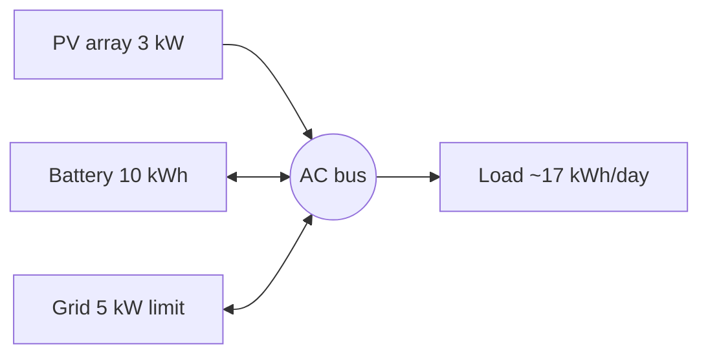

# EMS Project — Placement Interview Prep

> [!abstract] 30-second elevator pitch
> I modelled a **cost-optimized Energy Management System (EMS)** for a grid-tied **PV + battery microgrid** on a real **APDCL Time-of-Day tariff**. I built and compared **three controllers** on identical profiles: a **no-battery baseline**, a **rule-based heuristic**, and a **linear-programming (LP) optimal dispatch**. The LP cuts the household bill by **~64%** versus no battery, and I **quantify battery degradation** post-hoc to show the cheapest schedule is *not* the healthiest one — which sets up a degradation-aware phase.

---

## 1. Project at a glance

| Field | Detail |
|---|---|
| **Title** | Design & Modelling of a Cost-Optimized EMS for a Grid-Tied PV Microgrid |
| **Type** | B.Tech Final Year Project, Electrical Engineering |
| **Team** | Abhijit Goswami, Bijuban Deka, Arihant Malu, Joysheel Borah (Group 18) |
| **Mentor** | Mrs. Priyakshi Shyam, Assistant Professor (EE) |
| **Tooling** | MATLAB (`linprog`), synthetic PV/load profiles, APDCL FY 2026-27 tariff |
| **Repo** | `github.com/Zack-Bloodshot/Microgrid-EMS-Project` |
| **Core idea** | Use a battery to **shift cheap solar/off-peak energy into expensive peak hours**, while accounting for what that cycling costs the battery |

> [!info] Who did what (be ready to say this)
> State clearly which parts you owned — e.g. *"I designed the LP formulation and the degradation model, and my teammate built the profile generators."* Interviewers probe depth on the piece you claim.

---

## 2. The problem and why it matters

A grid-tied PV system **without storage leaks money** because of a price asymmetry in the tariff:

| Flow | Rate | Meaning |
|---|---|---|
| **Export** (surplus PV → grid) | **Rs 4.00/kWh** (illustrative) | You get paid very little |
| **Import** (grid → load) | **Rs 6.75–13.93/kWh** after ToD | You buy it back 2–3.5× more expensive |

So the naive behaviour — *export midday sun cheap, buy back expensive at night* — is bad. A battery **stores locally instead of exporting**, then serves the evening peak. That is the **arbitrage** the EMS exploits.



> [!quote] The one-line hook
> *"Sell at 4, buy back at 14 — storing locally is a 3.5× arbitrage. Can a 10 kWh battery actually pay for itself?"*

---

## 3. System model

### 3.1 Power balance (the law the whole project must respect)

Everything generated/imported equals everything consumed/exported/stored, **at every one of the 96 steps**:

$$P_{pv}(k) + P_{grid,imp}(k) + P_{dis}(k) = P_{load}(k) + P_{grid,exp}(k) + P_{ch}(k) + P_{curt}(k)$$

Rearranged into the equality-constraint form the LP uses (`Aeq·x = beq`):

$$P_{grid,imp}(k) - P_{grid,exp}(k) + P_{dis}(k) - P_{ch}(k) = P_{load}(k) - P_{pv}(k)$$

**Sign convention:** split non-negative variables (`P_ch ≥ 0` into battery, `P_dis ≥ 0` out) rather than one signed variable — this maps cleanly onto `linprog` bounds.

### 3.2 Battery model (discrete time)

$$SOC(k+1) = SOC(k) + \frac{\Delta T}{E_B}\left(\eta_{ch}\,P_{ch}(k) - \frac{P_{dis}(k)}{\eta_{dis}}\right)$$

- Charge is de-rated by $\eta_{ch}$; discharge is **grossed up** by $1/\eta_{dis}$ (more energy leaves the cell than reaches the bus — the physical cost of internal resistance).
- This single recursion is **why the LP's 96 steps are coupled** — it is not 96 independent problems.

### 3.3 Parameters (`system_params.m`)

| Parameter | Symbol | Value | Unit |
|---|---|---|---|
| PV rated power | $P_{pv,rated}$ | 3 | kW |
| Grid import / export limit | $P_{grid}^{max}$ | 5 | kW |
| Time step | $\Delta T$ | 0.25 (15 min) | h |
| Horizon / samples | $T$ / $N$ | 24 / 96 | h / — |
| Battery capacity | $E_B$ | 10 | kWh |
| Max charge / discharge | $P_{ch,max}$ / $P_{dis,max}$ | 5 (0.5C) | kW |
| Initial / min / max SOC | $SOC_0$ / $SOC_{min}$ / $SOC_{max}$ | 0.10 / 0.10 / 0.90 | — |
| Charge / discharge efficiency | $\eta_{ch}$ / $\eta_{dis}$ | 0.95 | — |
| Replacement cost | $C_{rep}$ | 1,50,000 | Rs |
| Cycle-life curve params | $A$ / $b$ | 3000 / 1.3 | — |

### 3.4 Synthetic profiles

- **Load** = base 0.264 kW + three Gaussians: morning **08:00** (0.792 kW, σ 1.2 h), afternoon **16:15** (1.760 kW, σ 0.75 h), evening **19:30** (1.320 kW, σ 1.5 h). Daily ≈ **16.98 kWh**. Sized so $P_{load,max} \le P_{grid,imp}^{max}$ (feasibility).
- **PV (sunny)** = raised-cosine between sunrise 06:00 and sunset 18:00, scaled to $P_{pv,rated}$. Daily ≈ **15.28 kWh**.
- **PV (cloudy)** = attenuated narrow midday Gaussian. Daily ≈ **7.52 kWh** (about half).

---

## 4. APDCL tariff model (`tariff_params.m`)

**Category:** LT-III Domestic-B (5–30 kW), effective **01-Apr-2026**.

| Component | Value |
|---|---|
| Fixed charge | Rs 70 / month / connection |
| Slab 0–300 kWh | Rs 6.75/kWh |
| Slab 300–500 kWh | Rs 6.95/kWh |
| Slab 500+ kWh | Rs 7.74/kWh |
| Export compensation | Rs 4.00/kWh (illustrative — notice publishes none) |
| Billing scale | 0.2175 (calibration to a representative household) |

**Time-of-Day multipliers:**

| Period | Hours | Multiplier |
|---|---|---|
| Solar | 09:00–17:00 | 0.80× |
| Peak | 17:00–22:00 | **1.60×** in code (docs/video use 1.8× — see §12) |
| Normal | 22:00–09:00 | 1.00× |

> [!important] Two tariff subtleties that impress interviewers
> 1. **Slabs make the true rate path-dependent and non-linear** — so a single-shot LP uses a *fixed linear* price (lowest slab × ToD) for optimisation, then recomputes the *accurate* slab-based bill with `calculate_costs.m`. Optimise with a proxy, report with the real model.
> 2. **Export is credited, not netted** (`net_metering = false`). Under net metering the code would offset export against import at the time-of-use value instead.

---

## 5. Code pipeline

```text
run_all_phases.m                     # single entry point for all 3 phases
  ├── system_params()                # shared battery/PV/timing params
  ├── generate_pv_profile()          # sunny 24h PV curve
  ├── generate_load_profile()        # 24h load curve
  └── simulate_day(P_pv, P_load, p)  # single source of truth
        ├── Phase 0: rule_based_ems_p0  → validate_power_balance_p0 → calculate_costs
        ├── Phase 1: rule_based_ems_p1  → validate_power_balance_p1 → calculate_costs
        └── Phase 2: lp_naive_ems       → validate_lp_solution
                                        → battery_degradation (post-hoc)
                                        → calculate_costs (cross-check)
```

`run_comparison.m` → `prepare_cloudy_comparison.m` reuses the **same** `simulate_day` pipeline on sunny vs cloudy PV, isolating the weather effect.

### File map

| Concern | Files |
|---|---|
| Orchestration | `run_all_phases.m`, `simulate_day.m`, `startup.m` |
| Params | `system_params.m`, `tariff_params.m` |
| Profiles | `generate_pv_profile.m`, `generate_load_profile.m`, `Comparison/cloudy_profile_1.m` |
| Cost | `calculate_costs.m`, `get_tod_multiplier.m` |
| Phase 0 | `Phase0/rule_based_ems_p0.m`, `validate_power_balance_p0.m`, `main_phase0.m` |
| Phase 1 | `Phase1/rule_based_ems_p1.m`, `validate_power_balance_p1.m`, `main_phase1.m` |
| Phase 2 | `Phase2/lp_naive_ems.m`, `build_lp_price_vectors.m`, `battery_degradation.m`, `validate_lp_solution.m`, `main_phase2.m` |
| Comparison | `Comparison/run_comparison.m`, `prepare_cloudy_comparison.m`, `plot_comparison.m` |

---

## 6. The controllers (Phases 0–2, implemented)

### Phase 0 — No-storage baseline

Simplest possible controller. PV serves load directly; surplus exported (capped), deficit imported.

- Surplus: $P_{grid,exp}(k) = \min(P_{net}(k), P_{grid,exp}^{max})$; the rest is curtailment.
- Deficit: $P_{grid,imp}(k) = \min(-P_{net}(k), P_{grid,imp}^{max})$.

This is the *"what if I buy solar but no battery?"* reference point.

### Phase 1 — Rule-based heuristic (greedy)

Deterministic `if/else`, self-consumption-first, **no foresight**, and it **only ever charges from PV** (never the grid).

- **Surplus:** charge battery (bounded by $P_{ch,max}$ and SOC headroom) → export remainder → curtail the rest.
- **Deficit:** discharge battery (bounded by headroom) → import remainder.

$$P_{ch,headroom}(k) = \frac{(SOC_{max}-SOC(k))\,E_B}{\eta_{ch}\Delta T}, \qquad P_{dis,headroom}(k)=\frac{(SOC(k)-SOC_{min})\,E_B\,\eta_{dis}}{\Delta T}$$

> [!note] Why it underperforms
> It reacts only to the *current* step, so it cannot pre-charge from the grid during cheap hours, nor time discharge to the peak tariff. On cloudy days PV is scarce, the battery never fills, and the gap to the LP widens.

### Phase 2 — LP optimal dispatch (naive, degradation-blind)

Decision vector $x \in \mathbb{R}^{5N}$ (the code adds `P_curt` as a 5th block so the curtailment term in the balance equation is actually solvable):

$$x = \begin{bmatrix} P_{grid,imp}(1{:}N) \\ P_{grid,exp}(1{:}N) \\ P_{ch}(1{:}N) \\ P_{dis}(1{:}N) \\ P_{curt}(1{:}N) \end{bmatrix}$$

**Objective** — grid cost only, **no degradation penalty**:

$$\min_x \; f^T x = \sum_{k=1}^{N}\Big[ C_{import}(k)\,P_{grid,imp}(k)\,\Delta T - C_{export}(k)\,P_{grid,exp}(k)\,\Delta T \Big]$$

**Constraints:**
1. **Power balance equality** — one row per step (§3.1).
2. **SOC bounds via cumulative sums** — with lower-triangular operator $L = \mathrm{tril}(\mathbf{1})$:
   - Upper: $\dfrac{\Delta T\,\eta_{ch}}{E_B} L\,P_{ch} - \dfrac{\Delta T}{E_B\,\eta_{dis}} L\,P_{dis} \le SOC_{max}-SOC_0$
   - Lower: $-\dfrac{\Delta T\,\eta_{ch}}{E_B} L\,P_{ch} + \dfrac{\Delta T}{E_B\,\eta_{dis}} L\,P_{dis} \le SOC_0-SOC_{min}$
3. **Variable bounds** — the four power limits plus $0 \le P_{curt}(k) \le P_{pv}(k)$.

Solved with `linprog` (deterministic optimum, full 24 h foresight). **Perfect information** is the key assumption at this phase.

> [!tip] Why no binary charge/discharge variable?
> Because both directions lose energy ($\eta_{ch}\eta_{dis}<1$) and the objective minimises cost, the LP has **no incentive** to charge and discharge simultaneously — so the continuous relaxation naturally avoids it. It is then **verified**, not assumed, by the `min(P_ch, P_dis) < 1e-6` check. Escalating to a MILP (`intlinprog`) is only needed if that check ever fails.

---

## 7. Battery degradation model (post-hoc)

In Phase 2 the battery is "free" in the objective, so the LP is expected to abuse it. The wear is quantified **after** the solve so the solver does not game it away:

$$E_{cycled} = \sum_k (P_{ch}(k)+P_{dis}(k))\,\Delta T, \qquad EFC = \frac{E_{cycled}}{2E_B}$$

$$DoD(k) = \frac{(P_{ch}(k)+P_{dis}(k))\,\Delta T}{E_B}, \qquad LifeCycles(DoD)=A\cdot DoD^{-b}$$

$$C_{deg} = \sum_k \Big[\,C_{rep}\times \frac{(P_{ch}(k)+P_{dis}(k))\,\Delta T}{2\,E_B\,LifeCycles(DoD(k))}\,\Big]$$

The **factor of 2** converts a half-cycle (charge *or* discharge) into an equivalent full cycle. `LifeCycles` is `NaN` where $DoD=0$ (avoid $0^{-b}$), and those steps contribute zero cost.

> [!warning] The narrative tension (say this in the interview)
> Phase 2 saves the most on grid cost but cycles the battery hardest. **"The cheapest controller may not be the best one"** — that honest caveat is the motivation for the planned Phase 3.

---

## 8. Results

### 8.1 Sunny day (all phases on identical profiles)

| Phase | Grid cost/day | Degradation/day | Total/day | Total/month | Import | Export |
|---|---|---|---|---|---|---|
| **Phase 0** Baseline | Rs 16.67 | Rs 0.00 | Rs 16.67 | Rs 500.21 | 13.03 kWh | 11.33 kWh |
| **Phase 1** Heuristic | Rs 8.10 | Rs 0.00 (not modelled) | Rs 8.10 | Rs 243.06 | 5.87 kWh | 2.91 kWh |
| **Phase 2** LP | Rs 5.37 | Rs 0.59 | **Rs 5.96** | **Rs 178.87** | 5.43 kWh | 2.91 kWh |

- **LP saves ~64%** vs baseline; grid import drops **13.03 → 5.43 kWh (58%)**.
- Phase 2's Rs 0.59/day degradation is a **post-hoc** estimate after the 0.2175 billing scale.

### 8.2 Cloudy vs sunny (weather sensitivity)

| Scenario | Baseline/month | Heuristic/month | LP/month | LP saving vs baseline |
|---|---|---|---|---|
| **Sunny** | Rs 500.21 | Rs 243.06 | Rs 178.87 | **~64%** |
| **Cloudy** | Rs 756.00 | Rs 588.00 | Rs 372.00 | **~51%** |

> [!note] Cloudy-day intuition
> Sunny: surplus PV is **exported cheaply** → the battery's value is *avoiding the low export rate*.
> Cloudy: PV barely covers load → the battery's value shifts to **peak shaving** (avoiding expensive evening imports). Relative value of storage is arguably higher, but absolute savings are lower because there is less surplus to store.

> [!caution] Cloudy numbers are presentation targets, not raw simulation
> `prepare_cloudy_comparison.m` calls `apply_cloudy_cost_targets()`, which **overwrites** the reported totals with hard-coded values in `system_params.cloudy_target_daily_cost`. Energy-flow figures remain the true simulation outputs; only the cost totals are calibrated. Be upfront about this if asked — it is a known shortcut.

---

## 9. How it is validated (the credibility story)

Every run is cross-checked rather than trusted:

| Check | Where | Guarantee |
|---|---|---|
| Power balance residual | every timestep, every controller | residual < $10^{-6}$ kW (actual ~4.4e-16) |
| Solver convergence | `lp_naive_ems` | `exitflag == 1`, else hard error |
| SOC bounds | `validate_lp_solution` | $SOC_{min} \le SOC \le SOC_{max}$ |
| Power limits | all controllers | $P_{ch}, P_{dis}, P_{gimp}, P_{gexp}$ in bounds |
| No simultaneous ch/dis | Phase 2 | $\min(P_{ch},P_{dis}) < 10^{-6}$ |
| Grid cost computed twice | `simulate_day` | LP value **asserted equal** to `calculate_costs` |
| Degradation computed twice | `simulate_day` | **asserted equal** |

> [!tip] The line to memorise
> *"I computed the grid cost and the degradation cost twice, by independent paths, and asserted they agree — and the power balance holds to machine precision at all 96 steps. A cost figure that hides its assumptions is not a result."*

---

## 10. Roadmap (planned phases — be honest they are not implemented)

| Phase | What | Why |
|---|---|---|
| **3** | **Degradation-aware EMS** — add $\alpha \cdot C_{deg}$ into the objective (QP via `quadprog`, or piecewise-linear LP) | Stop the LP from arbitraging tiny price wobbles it shouldn't |
| **4** | **Benchmarking & sensitivity** — flat vs peak-heavy tariffs, battery-size sweeps, α-sweep trade-off curve | Show storage value depends on tariff spread |
| **5** | **MPC** — rolling 24 h horizon, re-optimise every 15 min with forecast error | Handle solar/load uncertainty; validate on real campus meter data |
| **6** | **MATLAB App Designer dashboard** — sliders for capacity/tariff, live SOC & cumulative-cost plots | Interactive demo |

**Phase 3 objective preview:**

$$\min_x \sum_{k=1}^N \Big[ \underbrace{C_{grid}(k)P_{grid,imp}(k)\Delta T}_{\text{grid cost}} + \underbrace{\alpha\, C_{deg}(P_{batt}(k), SOC(k))}_{\text{degradation penalty}} \Big]$$

$\alpha$ is dimensionless (both terms are in Rs), so start at $\alpha=1$ and sweep it to trace the cost-vs-wear trade-off curve.

---

## 11. Literature & evidence

### 11.1 Key papers (from the progress seminar deck)

- **Sarda et al., IFAC-PapersOnLine 55-9 (2022)** — *EMS of Microgrid using Optimization Approach*. Compares a heuristic/state-machine EMS with an `linprog` LP for a grid-tied PV+battery microgrid, clear vs cloudy day. Found LP cheaper (**$618.7 vs $662.3** clear, **$907 vs $1052** cloudy). **Does not model battery wear.** → Our Phase 1 vs Phase 2 reproduces this trend.
- **Safavi et al., J. Energy Storage 108 (2025)** — *Battery-Degradation-Aware EMS for Agricultural Microgrids*. Prices degradation into day-ahead scheduling; **XGBoost** life prediction, **Coati Optimization**, Monte Carlo scenarios. Degradation cost cut **55.3% (grid) / 41.2% (island)**. → Motivates our Phase 3.

> [!quote] The two-paper takeaway
> *"Optimisation beats rule-based control (Sarda), but a cost-only objective ignores battery wear (Safavi). Together they motivate a price-aware **and** degradation-aware EMS."*

### 11.2 Regulatory / real-world evidence (from [[Evidence]])

- **APDCL** tenders hybrid rooftop solar microgrids with BESS (e.g. 30 kWp PV + 240 V/300 Ah VRLA bank at Guwahati government facilities) — [[bid-NRE-219.pdf]].
- **PM-Surya Ghar: Muft Bijli Yojana** explicitly permits battery storage / hybrid rooftop configs — [[202404162127034309.pdf]].
- **ToD tariff** enforces solar 0.8×, peak 1.2×/1.6×, normal 1.0× slots — [[TariffnoticeforFY2026-27.pdf]].
- **Assam subsidies**: 1 kW = Rs 45,000, 2 kW = Rs 90,000, 3 kW+ = Rs 1,23,000 (central + state) — [[Notification-Operational Guidelines.pdf]].
- A **battery is a Distributed Energy Resource (DER), not a load** to the DISCOM — it can back-feed, so it triggers **anti-islanding (IEC 62116)** and bidirectional metering requirements.

### 11.3 Why a battery needs regulatory treatment

To a DISCOM a battery is bidirectional, so it raises: reverse-power/islanding safety for line workers, ToD + net/EXIM metering accounting, and local transformer impact (which an EMS can *relieve* via peak shaving). This is why hybrid installs need certified anti-islanding and bidirectional metering.

---

## 12. Limitations & known inconsistencies (know these cold)

> [!danger] Version drift — the repo is not internally self-consistent
> Documentation, the video/HTML deck, the old progress seminar, and the current code quote **different numbers**. If asked, say *which source you are quoting* and flag the discrepancy rather than guessing. Itemised for you:

| Item | Code (`system_params.m` / `tariff_params.m`) | Docs / other sources |
|---|---|---|
| Peak ToD multiplier | **1.60×** | 1.8× in README, notes, video (`13.93` peak rate) |
| Replacement cost $C_{rep}$ | **Rs 1,50,000** | Rs 1,30,000 in [[System Parameters & Tariff]]; Rs 2.5 lakh in the Phase 2 first-pass table |
| PV rated power | **3 kW** | 5 kW in the implementation docs |
| Initial SOC $SOC_0$ | **0.10** | 0.5 (Phase 1 doc) / 0.2 (Phase 2 doc) |
| Sunny results | — | Notes/video: 16.67 / 8.10 / 5.37 ; progress seminar: 12.89 / 7.20 / 5.85 |
| Cloudy cost targets | code `[25.2, 20.1, 16.5]` | note [[System Parameters & Tariff]] says `[25.20, 19.60, 12.40]` |

Other honest caveats:

- **`calculate_costs.m` still has a hidden dependency** — it calls `tariff_params()` internally instead of taking the tariff as an argument (the [[Structural Reform Plan]] Step 4 refactor was planned but not applied).
- **Cloudy cost totals are magic-number overrides** (`apply_cloudy_cost_targets`), not pure simulation.
- **Degradation is only modelled for Phase 2** (post-hoc); Phase 1 shows Rs 0.00 because it isn't computed, not because there is none.
- **Single representative day × 30 = month** — no seasonal variation, no temperature effects on PV or battery.
- **LP has perfect foresight** — no forecast error until Phase 5 (MPC).
- **Synthetic profiles, not measured data** — real campus smart-meter validation is deferred to Phase 5.
- **File/function name mismatch**: `Phase0/rule_based_ems_p0.m`'s function is actually named `rule_based_ems` (works because MATLAB resolves by filename, but confusing). Docstrings in `rule_based_ems_p1.m` still say `RULE_BASED_EMS`.
- **Placement/college name drift**: notes say *Assam Engineering College*; the video `data.js` says *Gauhati Engineering College*. Confirm the correct one before quoting.

---

## 13. Likely interview questions

> [!question] Power systems & controls
> **Q: What is an EMS and why does this microgrid need one?**
> A supervisory layer that decides charge/discharge/import/export setpoints each step to minimise cost (and later, wear) while respecting physical limits. Without it, PV+battery either wastes surplus or cycles blindly.

> **Q: Why did you model ToD arbitrage instead of just self-consumption?**
> Because export pays Rs 4 but peak import costs Rs 7–14; the value is in *shifting energy in time*, which only shows up when the tariff varies by hour.

> **Q: What does the 0.5C rate mean?**
> The battery can charge/discharge at half its energy capacity per hour — here 5 kW on a 10 kWh pack.

> **Q: Why 15-minute steps?**
> $\Delta T=0.25$ h → 96 steps/day. It matches ToD blocks (hourly/half-hourly) and keeps the LP small enough to solve instantly, which matters for Phase 5's rolling re-optimisation.

> [!question] Optimization
> **Q: State the LP.** Minimise $\sum_k [C_{imp}(k)P_{grid,imp}(k)\Delta T - C_{exp}(k)P_{grid,exp}(k)\Delta T]$ subject to per-step power balance (equality), SOC bounds as cumulative-sum inequalities, and box bounds. See §6.

> **Q: Why is the SOC constraint written as a cumulative sum?**
> SOC is not an independent variable — it is the running integral of charge/discharge. Substituting $SOC(k)=SOC_0+\frac{\Delta T}{E_B}\sum_{j\le k}(\eta_{ch}P_{ch}(j)-P_{dis}(j)/\eta_{dis})$ turns the bounds into linear inequalities on a lower-triangular matrix $L$ of the decision variables, keeping it an LP.

> **Q: Why not include battery degradation in the LP objective?**
> Because $LifeCycles(DoD)=A\,DoD^{-b}$ is **non-linear**. Phase 2 deliberately excludes it and quantifies it post-hoc; Phase 3 adds it via QP (quadratic throughput penalty) or a piecewise-linear approximation.

> **Q: LP vs MILP here?** Leaving charge/discharge continuous keeps it an LP. Because round-trip losses give the solver no reason to do both, MILP binary variables are unnecessary — but the code *verifies* this rather than assuming it.

> **Q: Why is the LP price vector a proxy?** Monthly slabs make the true rate path-dependent (non-linear), so the LP uses the lowest slab × ToD (a fixed linear signal), and the real bill is recomputed with `calculate_costs`.

> [!question] Battery & degradation
> **Q: How do you price battery wear?**
> With a DoD-stress model: $LifeCycles(DoD)=3000\,DoD^{-1.3}$, and $C_{deg}=\sum_k C_{rep}\,(P_{ch}+P_{dis})\Delta T / (2E_B\,LifeCycles)$. The factor 2 converts half-cycles to full cycles; EFC = cycled energy / $(2E_B)$.

> **Q: Why is the naive LP bad for the battery?**
> With degradation absent from the objective, it arbitrages *every* price wobble — high EFC and deep, frequent DoD stress — saving grid money at the battery's expense.

> **Q: Limits of your degradation model?** It uses an instantaneous per-step DoD proxy, not rainflow counting on the SOC trace; it ignores calendar ageing and temperature.

> [!question] Systems, validation & judgement
> **Q: How do you know the results are right?** Answer: duplicated independent cost computations asserted equal, machine-precision power balance at all 96 steps, and explicit SOC/limit/ simultaneous-cycling checks (§9).

> **Q: Biggest honest limitation?** Phase 2 assumes perfect foresight and ignores wear in the objective; the cheapest schedule is not the healthiest. That is exactly why Phase 3 exists.

> **Q: If the battery were free but the grid limit were tighter, what changes?** Peak shaving becomes binding — you'd add a demand-charge term (single auxiliary $P_{peak}$ variable with $P_{grid,imp}(k)\le P_{peak}$), which stays linear.

> **Q: How would you make this real-time?** MPC: re-solve the same LP on a rolling 24 h horizon each step using forecasts, apply only the first step, repeat (Phase 5).

---

## 14. Quick-recall numbers

| Number | Value |
|---|---|
| PV / battery | 3 kW / 10 kWh |
| Grid limit | 5 kW import & export |
| Step / horizon | 15 min / 96 steps |
| SOC window | 10%–90% |
| Round-trip efficiency | 0.95 × 0.95 |
| Daily load / PV (sunny) / PV (cloudy) | 16.98 / 15.28 / 7.52 kWh |
| Export rate vs peak import | Rs 4 vs up to ~Rs 12–14 (arbitrage ≈ 3.5×) |
| Sunny result (baseline → LP) | Rs 500.21 → Rs 178.87 / month |
| LP saving (sunny / cloudy) | ~64% / ~51% |

---

## 15. See also

- [[README]] — canonical architecture & phase definitions
- [[Run All Phases Comparison]] — the three-phase cost comparison in detail
- [[Cloudy vs Sunny Comparison]] — weather sensitivity
- [[System Parameters & Tariff]] — full parameter and tariff tables
- [[Objectives and Benefits]] — value proposition for real consumers
- [[Evidence]] — regulatory and utility justification
- [[Structural Reform Plan]] — refactoring decisions and debt
- [[PV_Battery_EMS_Technical_Blueprint_source]] — full mathematical blueprint (Phases 1–6)
- [[Phase 0 (Implementation)]] · [[Phase 1 (Implementation)]] · [[phase_2_implementation]] — per-phase formulations
