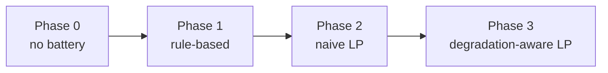

# Phase 3 — Degradation-Aware Optimization

> [!success] Status: implemented and verified
> The Phase 3 solver, validator, driver, sweep, and verification script are in
> `Matlab/Phase3/`. Measured results on the sunny day at $\alpha=1$:
> **grid Rs 26.88/day + wear Rs 22.10/day = Rs 48.97/day**, EFC **0.680**.
> `verify_phase3` reports **OVERALL: PASS**. See [[Phase 3 Results]] for the
> full measured record.

```matlab
[P_ch, P_dis, P_gimp, P_gexp, SOC, P_curt, ...
 grid_cost, deg_cost, objective_value] = ...
    lp_degradation_aware_ems(P_pv, P_load, tariff, params, alpha)
```

# Inputs

- $P_{pv}$ — PV generation at each timestep [kW]
- $P_{load}$ — load demand at each timestep [kW]
- $tariff$ — ToD tariff struct from `tariff_params()`
- $params$ — system/battery struct from `system_params()`
- $\alpha$ — dimensionless degradation weight; defaults to $1$

# Outputs

- $P_{ch}$ — battery charge power [kW], $\ge 0$
- $P_{dis}$ — battery discharge power [kW], $\ge 0$
- $P_{gimp}$ — grid import power [kW], $\ge 0$
- $P_{gexp}$ — grid export power [kW], $\ge 0$
- $SOC$ — state of charge trajectory, $1 \times (N+1)$, $SOC(1)=SOC_0$
- $P_{curt}$ — curtailed PV power [kW], $0 \le P_{curt}(k) \le P_{pv}(k)$
- $grid\_cost$ — actual bill from `calculate_costs()` [Rs]
- $deg\_cost$ — actual degradation cost from `battery_degradation_dod()` [Rs]
- $objective\_value$ — solver objective [Rs]; includes $\alpha$, so it is not a
  physical cost when $\alpha \ne 1$

# Parameters Used

These are the current values from `system_params.m` and `tariff_params.m`.
They are **not** the historical first-pass guesses in the Phase 0/1/2 notes.

| Parameter | Symbol | Value | Unit |
|---|---|---:|---|
| PV rated power | $P_{pv,rated}$ | 3 | kW |
| Battery capacity | $E_B$ | 10 | kWh |
| Max charge power | $P_{ch,max}$ | 5 | kW |
| Max discharge power | $P_{dis,max}$ | 5 | kW |
| Initial SOC | $SOC_0$ | 0.10 | — |
| SOC limits | $SOC_{min}, SOC_{max}$ | 0.10, 0.90 | — |
| Efficiencies | $\eta_{ch}, \eta_{dis}$ | 0.95, 0.95 | — |
| Timestep | $\Delta t$ | 0.25 | h |
| Horizon | $N$ | 96 | steps |
| Grid limits | $P_{gimp,max}, P_{gexp,max}$ | 5, 5 | kW |
| Replacement cost | $C_{rep}$ | 130,000 | Rs |
| Rated depth of discharge | $DoD_{rated}$ | 0.80 | — |
| Rated cycle life at $DoD_{rated}$ | $N_{cycles,rated}$ | 5000 | cycles |
| Diagnostic cycle-life exponent | $b_{cycle}$ | 1.3 | — |

> [!note] Where 80% comes from
> The usable SOC window is $SOC_{max}-SOC_{min}=0.90-0.10=0.80$. The code
> derives $DoD_{rated}$ from those two parameters rather than hard-coding
> `0.8`, so changing the SOC limits updates the degradation model
> automatically.

> [!warning] Phase 2 still uses the legacy model
> `Matlab/Phase2/battery_degradation.m` remains on the legacy 100%-DoD
> $A_{cycle}=5000$ throughput model, so Phase 2 and Phase 3 price wear
> differently. Phase 3 uses `battery_degradation_dod.m`. Any Phase 2 versus
> Phase 3 comparison must label which degradation model prices each row.

> [!note] Units
> Power is in kW, energy in kWh, time in hours, and money in Rs. SOC is a
> fraction in $[0,1]$. Keeping these units consistent is what makes $\alpha$
> dimensionless.

---

# Why This Phase Exists

Phase 2 is deliberately **degradation-unaware**. Its LP minimises only the
grid bill, then prices the resulting wear afterwards. On the sunny day:

| Quantity | Phase 0 (no battery) | Phase 2, legacy model | Phase 2 dispatch, repriced at 80% DoD / 5000 cycles |
|---|---:|---:|---:|
| Grid cost | Rs 50.54/day | Rs 24.69/day | Rs 24.69/day |
| Post-hoc degradation | Rs 0.00/day | Rs 20.83/day | Rs 26.03/day |
| **Total physical cost** | **Rs 50.54/day** | **Rs 45.51/day** | **Rs 50.72/day** |
| EFC | 0.000 | 0.801 | 0.801 |

Two things are true at once:

1. Under the **legacy** 5000-cycle, 100%-DoD model, the battery already looks
   economic: Phase 2 cuts electricity spend by Rs 25.85/day and adds
   Rs 20.83/day of wear, for a total of Rs 45.51/day — **Rs 5.03/day better**
   than doing nothing.
2. Under the **updated** 5000-cycle, 80%-DoD model, the *same* Phase 2 dispatch
   is repriced at Rs 26.03/day of wear. Total cost becomes Rs 50.72/day, which
   is **Rs 0.18/day worse** than the no-battery baseline.

That reversal is the point. The two models disagree about whether Phase 2's
aggressive cycling pays for itself, so a controller that prices wear *inside*
the objective is worth building. Phase 3 prices wear at its modelled cost, trims
the marginal cycling, and lands at Rs 48.97/day under the stricter model —
better than both the repriced Phase 2 dispatch (Rs 50.72/day) and the
no-battery baseline (Rs 50.54/day).

> [!important] Phase 2 and Phase 3 are not like-for-like as reported
> The repriced Phase 2 column is a **recalculation of the existing dispatch**
> under the Phase 3 degradation model, not a Phase 2 code change. Phase 2's own
> row still uses the legacy model and therefore shows a lower total
> (Rs 45.51/day) than Phase 3 (Rs 48.97/day). Compare Phase 3 only against the
> **repriced** Phase 2 figure (Rs 50.72/day) when judging the controller.

![[all-phase-cost-comparison.png|700]]

*Figure 1 — Measured daily cost components for all four controllers. Phase 2
and Phase 3 use different degradation models; Phase 3's lower wear is not a
like-for-like comparison against the Phase 2 bar.*



---

# Mathematical Formulation

## 1. Decision Vector

The decision vector is the same $5N$ layout as Phase 2:

$$
x =
\begin{bmatrix}
P_{gimp}(1:N) \\
P_{gexp}(1:N) \\
P_{ch}(1:N) \\
P_{dis}(1:N) \\
P_{curt}(1:N)
\end{bmatrix}
\in \mathbb{R}^{5N},
\qquad x \ge 0
$$

Keeping the layout identical means the same constraints, validator, and
plotting code can be reused, and the only change is the objective.

## 2. Objective Function

$$
\min_x \sum_{k=1}^{N}
\left[
\underbrace{C_{imp}(k)\,P_{gimp}(k)\,\Delta t}_{\text{grid import cost}}
-
\underbrace{C_{exp}\,P_{gexp}(k)\,\Delta t}_{\text{export credit}}
+
\underbrace{\alpha\,c_{deg}\,(P_{ch}(k)+P_{dis}(k))\,\Delta t}_{\text{battery wear}}
\right]
$$

where $C_{imp}(k)$ is the ToD import price from `build_lp_price_vectors()` and
$C_{exp}$ is the assumed export credit (Rs 4.00/kWh).

The first two terms are exactly Phase 2's objective. The third term is the new
degradation penalty.

## 3. Degradation Term

Phase 3 uses `battery_degradation_dod.m`. The cost is still linear in energy
throughput, but the rated cycle life is evaluated at the usable depth of
discharge rather than at 100% DoD.

$$
E_{cycled} = \sum_{k=1}^{N}\left(P_{ch}(k)+P_{dis}(k)\right)\Delta t
$$

$$
EFC = \frac{E_{cycled}}{2E_B}
$$

$$
E_{cycle,rated} = 2E_B\,DoD_{rated}
$$

$$
C_{deg} = c_{deg}\,E_{cycled},
\qquad
c_{deg} = \frac{C_{rep}}{N_{cycles,rated}\,E_{cycle,rated}}
$$

Substituting the current values:

$$
DoD_{rated} = SOC_{max}-SOC_{min} = 0.90-0.10 = 0.80
$$

$$
E_{cycle,rated} = 2(10)(0.80) = 16\ \text{kWh/rated cycle}
$$

$$
c_{deg}
= \frac{130000}{5000 \times 16}
= 1.6250\ \text{Rs/kWh throughput}
$$

So one rated cycle at 80% DoD costs:

$$
\frac{C_{rep}}{N_{cycles,rated}}
= \frac{130000}{5000}
= 26.00\ \text{Rs/cycle}
$$

One equivalent **full** cycle (100% DoD, $2E_B=20$ kWh) costs:

$$
c_{deg} \times 2E_B
= 1.6250 \times 20
= 32.50\ \text{Rs/EFC}
$$

> [!important] Why this term is the right one
> The optimiser's degradation penalty and the reported degradation metric use
> the **same** linear throughput model. At $\alpha=1$, the wear term is priced
> at exactly the modelled cost, so the trade-off between grid cost and wear is
> internally consistent.
>
> The solver's grid term uses the linearised ToD price from
> `build_lp_price_vectors()`, while the reported bill uses the slab-based
> `calculate_costs()`. Therefore `objective_value` is **not** the physical
> total; the measured physical total is `grid_cost + deg_cost`. This is the
> same approximation Phase 2 makes, so the comparison stays fair.
>
> A quadratic proxy such as $\beta(P_{ch}+P_{dis})^2$ would penalise large
> power swings more heavily, but it would optimise a *different* quantity than
> the one reported. It would need its own calibration before the results could
> be compared fairly.

> [!question] Why not use the per-timestep DoD in the cost?
> Because a 15-minute DoD slice is not the depth of a complete cycle. The
> rated DoD of 80% is the design cycle depth; it sets how much energy one rated
> cycle moves. Using the tiny per-timestep slice directly would understate wear
> by orders of magnitude. Cycle-level depth accounting requires rainflow
> counting, which is future work.

> [!note] Is 5000 cycles at 80% DoD reasonable?
> Yes for a modern LFP pack. 5000 cycles at 80% DoD is within the commercial
> LFP range, and it corresponds to $5000 \times 0.8 = 4000$ equivalent full
> cycles. At the Phase 2 cycling rate of 0.801 EFC/day that is about 14 years
> of cycling life, so calendar aging (typically 10–15 years) would dominate
> first. The figure is optimistic but not implausible for the stated pack.

## 4. Constraints

### 4.1 Power balance

At every timestep:

$$
P_{gimp}(k) - P_{gexp}(k) + P_{dis}(k) - P_{ch}(k) - P_{curt}(k)
= P_{load}(k) - P_{pv}(k)
$$

### 4.2 Battery dynamics

$$
SOC(k+1) = SOC(k) + \frac{\Delta t}{E_B}
\left(
\eta_{ch}P_{ch}(k) - \frac{P_{dis}(k)}{\eta_{dis}}
\right)
$$

### 4.3 SOC operating bounds

Using the same lower-triangular cumulative-sum form as Phase 2:

$$
SOC_0 + \frac{\Delta t}{E_B}\sum_{j=1}^{k}
\left(
\eta_{ch}P_{ch}(j) - \frac{P_{dis}(j)}{\eta_{dis}}
\right)
\in [SOC_{min}, SOC_{max}],
\quad k = 1,\dots,N
$$

### 4.4 Terminal SOC

Phase 2 leaves $SOC(N+1)$ free. Phase 3 adds:

$$
SOC(N+1) \ge SOC_0
$$

which simplifies to:

$$
\sum_{j=1}^{N}
\left(
\eta_{ch}P_{ch}(j) - \frac{P_{dis}(j)}{\eta_{dis}}
\right)
\ge 0
$$

> [!warning] Why the terminal constraint matters
> Without it, the optimiser can drain the battery at the end of the day at no
> cost, because the horizon simply stops. That would bias any degradation
> study. Requiring $SOC(N+1)\ge SOC_0$ prevents free end-of-day energy
> extraction without forcing an artificial exact equality.

### 4.5 Decision-variable bounds

$$
0 \le P_{gimp}(k) \le P_{gimp,max}
$$
$$
0 \le P_{gexp}(k) \le P_{gexp,max}
$$
$$
0 \le P_{ch}(k) \le P_{ch,max}
$$
$$
0 \le P_{dis}(k) \le P_{dis,max}
$$
$$
0 \le P_{curt}(k) \le P_{pv}(k)
$$

No binary variables are introduced. With positive prices and a positive
degradation penalty, simultaneous charge and discharge is not profitable; it is
still checked after the solve.

## 5. What Alpha Means

$\alpha$ is **dimensionless** because both the grid term and the degradation
term are already in Rs.

| Value | Meaning |
|---|---|
| $\alpha = 0$ | Recover Phase 2 exactly: wear ignored. |
| $0 < \alpha < 1$ | Wear under-priced; the controller still cycles for arbitrage. |
| $\alpha = 1$ | Wear priced at its modelled cost. |
| $\alpha > 1$ | Conservative; penalise wear more heavily. |

The key reporting rule:

> [!important] Alpha is a controller setting, not a billing assumption
> Reported `grid_cost`, `deg_cost`, and `total_cost` always use the **actual**
> grid bill and the **actual** degradation cost. $\alpha$ only changes the
> dispatch the solver chooses. The alpha sweep is a decision-support curve,
> not a set of different electricity prices.

---

# Measured Result

All numbers below come from an actual `run_all_phases()` / `verify_phase3()`
run on MATLAB R2024b, sunny day, $\alpha=1$ unless stated.

## Headline case ($\alpha = 1$)

| Quantity | Phase 0 | Phase 1 | Phase 2 (legacy model) | **Phase 3** |
|---|---:|---:|---:|---:|
| Grid cost [Rs/day] | 50.54 | 28.97 | 24.69 | **26.88** |
| Degradation [Rs/day] | 0.00 | 20.83 | 20.83 | **22.10** |
| **Total [Rs/day]** | **50.54** | **49.80** | **45.51** | **48.97** |
| EFC | 0.000 | 0.801 | 0.801 | **0.680** |

For a like-for-like comparison, Phase 2's dispatch repriced under the Phase 3
wear model gives:

$$
24.69 + 26.03 = 50.72\ \text{Rs/day}, \qquad EFC = 0.801
$$

Phase 3 therefore saves **Rs 1.74/day** relative to the same dispatch priced
with the same wear model. It does this by cycling less: EFC falls from 0.801 to
0.680, grid cost rises by Rs 2.19/day, and wear falls by Rs 3.94/day.

The Phase 2 and Phase 1 rows above use the **legacy** 100%-DoD model and are not
directly comparable with the Phase 3 row. Under the stricter Phase 3 wear model,
the no-battery baseline is Rs 50.54/day, repriced Phase 2 is Rs 50.72/day, and
Phase 3 is Rs 48.97/day.

Daily energy at $\alpha=1$: battery charged 7.147 kWh, discharged 6.450 kWh,
grid imported 6.583 kWh, grid exported 4.183 kWh, PV curtailed 0.000 kWh,
final SOC 0.100.

![[phase3-dispatch-soc.png]]

*Figure 2 — Phase 3 dispatch at $\alpha=1$: PV vs load, charge/discharge and
grid flows, SOC with the terminal target, curtailment, and the per-timestep
throughput slice (diagnostic only).*

## Alpha sweep

| $\alpha$ | Grid [Rs/day] | Degradation [Rs/day] | Total [Rs/day] | EFC | Final SOC |
|---:|---:|---:|---:|---:|---:|
| 0.00 | 24.69 | 26.03 | 50.72 | 0.801 | 0.100 |
| 0.25 | 24.69 | 26.03 | 50.72 | 0.801 | 0.100 |
| 0.50 | 25.02 | 24.83 | 49.86 | 0.764 | 0.100 |
| 0.75 | 26.88 | 22.10 | 48.97 | 0.680 | 0.100 |
| 1.00 | 26.88 | 22.10 | 48.97 | 0.680 | 0.100 |
| 1.25 | 50.54 | 0.00 | 50.54 | 0.000 | 0.100 |
| 1.50 | 50.54 | 0.00 | 50.54 | 0.000 | 0.100 |
| 2.00 | 50.54 | 0.00 | 50.54 | 0.000 | 0.100 |
| 3.00 | 50.54 | 0.00 | 50.54 | 0.000 | 0.100 |
| 5.00 | 50.54 | 0.00 | 50.54 | 0.000 | 0.100 |

- $\alpha = 0$ reproduces Phase 2's dispatch exactly (grid cost difference
  `0.00e+00`); the wear column is repriced under the Phase 3 model.
- Small $\alpha$ barely changes the dispatch, as expected.
- $\alpha=1$ trims marginal cycling while keeping the valuable windows.
- By $\alpha=1.25$ the controller idles the battery and falls back to the
  no-battery baseline of Rs 50.54/day.
- The knee ($EFC \le 0.5\,EFC(\alpha=0)$) is **$\alpha = 1.25$**.

> [!success] This is the result that makes Phase 3 worth presenting
> Phase 3 is not "add a penalty and watch the battery switch off". Under the
> stricter 80%-DoD / 5000-cycle model it keeps the valuable cycling and drops
> the marginal cycling: total cost falls from Rs 50.72/day (naive dispatch,
> same wear model) to Rs 48.97/day. That is also below the no-battery baseline
> of Rs 50.54/day. The sweep shows where the boundary sits, and the honest
> finding is that at $\alpha\ge1.25$ the battery is not worth cycling at all on
> this tariff.

![[phase3-alpha-sweep.png|700]]

*Figure 3 — Phase 3 trade-off: grid cost, battery wear, total physical cost,
and EFC versus $\alpha$. The knee is $\alpha=1.25$.*

## Cloudy-day result

| Quantity | Phase 0 | Phase 1 | Phase 2 (legacy) | Phase 3 |
|---|---:|---:|---:|---:|
| Grid cost [Rs/day] | 87.14 | 79.47 | 66.37 | 71.78 |
| Degradation [Rs/day] | 0.00 | 11.48 | 19.88 | 14.35 |
| **Total [Rs/day]** | **87.14** | **90.94** | **86.25** | **86.13** |
| EFC | 0.000 | 0.441 | 0.765 | 0.441 |

On the cloudy day Phase 3 beats the no-battery baseline by **Rs 1.01/day**
(86.13 vs 87.14) and edges out Phase 2 as reported (86.25). It shifts the
limited PV into the expensive evening window instead of exporting it cheaply.
Phase 1 and Phase 2 are priced with the legacy 5000-cycle model; Phase 3 uses
the 80%-DoD / 5000-cycle model, so the degradation columns are not
like-for-like.

> [!warning] Do not quote the old Rs 4.45/kWh figure
> That number came from the legacy 3000-cycle model. Under the current 5000-cycle
> models the throughput cost is Rs 1.300/kWh for legacy Phase 2 and
> Rs 1.625/kWh for Phase 3. Keep the two models clearly separated in the report.

---

# Post-Simulation Validation

Every Phase 3 run must pass the same gates as Phase 2, plus the terminal-SOC
check:

1. **Solver convergence** — `exitflag == 1`, enforced inside the solver.
2. **Power balance** — max residual $< 10^{-6}$ kW.
3. **SOC bounds** — $SOC(k)\in[SOC_{min},SOC_{max}]$.
4. **Terminal SOC** — $SOC(N+1) \ge SOC_0 - 10^{-9}$.
5. **Power limits** — charge, discharge, import, and export within bounds.
6. **Curtailment** — $0 \le P_{curt}(k) \le P_{pv}(k)$.
7. **No simultaneous charge/discharge** — not both above tolerance.
8. **Cost cross-checks** — solver `grid_cost` matches `calculate_costs()`;
   solver `deg_cost` matches `battery_degradation_dod()`.
9. **Alpha-zero equivalence** — Phase 3 at $\alpha=0$ matches Phase 2's grid
   cost within $10^{-6}$ Rs. Degradation is **not** expected to match, because
   Phase 2 still uses the legacy model.

Measured verification output (`verify_phase3`, MATLAB R2024b):

| Check | Result | Detail |
|---|---|---|
| Phase 2 legacy baseline frozen | PASS | grid 24.6857, degr 20.8274, EFC 0.8011 |
| DoD-aware degradation constants | PASS | DoD 0.80, 1.6250 Rs/kWh, 26.00 Rs/cycle |
| $\alpha=0$ matches Phase 2 grid cost | PASS | diff `0.00e+00` Rs |
| Terminal SOC $\ge SOC_0$ | PASS | min SOC(end) = 0.1000 |
| Power balance residual | PASS | max 4.44e-16 kW |
| SOC / power / curtailment bounds | PASS | all Phase 3 runs |
| No simultaneous charge/discharge | PASS | all Phase 3 runs |
| Cloudy profile solves and validates | PASS | grid 71.78 Rs, EFC 0.441 |
| Alpha sweep monotonic and valid | PASS | knee $\alpha=1.25$ |
| `total_cost = grid + degradation` | PASS | 48.9738 Rs/day |
| **OVERALL** | **PASS** | |

The repeatable entry point is:

```matlab
cd Matlab
startup
verify_phase3
```

---

# Why This Looks Good in a Progress Report

> [!tip] The short version
> Phase 3 is not "another controller". It is the phase where the project stops
> asking *"which controller saves the most?"* and starts asking *"what does
> 'saving' mean once battery wear is priced?"*

Professors tend to reward the following, and this phase demonstrates all of
them:

1. **A clear progression of ideas.** Baseline → heuristic → optimisation →
   multi-objective optimisation. Each phase fixes a limitation of the previous
   one, rather than being a disconnected demo.
2. **A real problem statement, backed by measured numbers and a model update.**
   Phase 2 saves Rs 25.85/day on electricity. Under the legacy wear model it
   adds Rs 20.83/day; under the stricter 80%-DoD / 5000-cycle model the same
   dispatch adds Rs 26.03/day, which flips the total slightly above the
   no-battery baseline. That is a concrete motivation and a defensible reason
   for pricing wear inside the objective.
3. **Correct formulation.** The objective, constraints, units, and terminal
   condition are stated explicitly. $\alpha$ is dimensionless and its meaning
   is precise.
4. **Justified solver choice.** Staying with `linprog` is defensible because
   the degradation model is linear in throughput. The note explains why a QP
   proxy would not match the reported metric.
5. **Fair comparison.** Same profiles, same tariff, same constraints. At
   $\alpha=0$ the new solver must reproduce Phase 2; that is a strong sanity
   check.
6. **Sensitivity analysis, not a single answer.** The alpha sweep produces a
   cost-versus-wear curve and a knee, which is more useful to a decision-maker
   than one arbitrary weighting.
7. **A defensible result, not a foregone conclusion.** The updated model makes
   the trade-off real: some cycling is worth keeping, some is not. The report
   shows where the boundary sits instead of asserting a preferred answer.
8. **Verification.** Power balance, SOC bounds, terminal SOC, no simultaneous
   cycling, and cost cross-checks are all shown. The work is reproducible.
9. **Clear limitations and future work.** Single-day horizon, synthetic
   profiles, linearised degradation, and no rainflow counting are stated
   rather than hidden.

## Suggested Progress-Report Sequence

1. **Motivation** — show the two-model table: legacy wear makes the battery look
   uneconomic, corrected 80%-DoD / 5000-cycle wear makes it economic. Phase 3
   asks how much cycling is still worth doing.
2. **Formulation** — write the objective, the DoD-aware wear term, and the
   terminal-SOC constraint. Explain that $\alpha=1$ means "price wear at its
   modelled cost".
3. **Method** — state that the problem stays an LP because the degradation
   model is linear in throughput, so the solver returns a global optimum.
4. **Result** — show the alpha sweep and the dispatch/SOC for the headline
   case. Point out which cycling windows survive at $\alpha=1$.
5. **Credibility** — show the validation table, the $\alpha=0$ equivalence
   check, and the limitations. End with what Phase 4/5 would add.

Figures worth preparing: daily cost breakdown (Phase 0/1/2/3), grid cost and
EFC versus alpha, and one dispatch/SOC pair for the chosen alpha.

## Anticipated Questions

> [!question] "Why not use the non-linear $LifeCycles(DoD)=A\,DoD^{-b}$ curve directly?"
> Because a 15-minute DoD slice is not the depth of a complete cycle. Using it
> directly understates degradation by orders of magnitude. Phase 3 therefore
> evaluates the rated life at the design DoD of 80%, where one cycle moves
> $2E_B DoD = 16$ kWh. The per-timestep DoD and `LifeCycles` curve are retained
> as diagnostics only. Cycle-level depth accounting requires rainflow counting,
> which is future work.

> [!question] "Why 5000 cycles at 80% DoD? Isn't that too optimistic?"
> 5000 cycles at 80% DoD is within the commercial LFP range and equals 4000
> equivalent full cycles. For a 10 kWh pack at Rs 130,000, that works out to
> about Rs 1.625 per kWh of throughput, which is plausible. At 0.801 EFC/day it
> implies roughly 14 years of cycling life, so calendar aging would likely
> dominate first. The assumption is optimistic but defensible; the report
> should state it as an assumption, not a measured datasheet value.

> [!question] "Why is $\alpha=1$ the headline?"
> Because $\alpha=1$ is the only value that prices wear at its modelled cost.
> The sweep also reports the knee, which is the economically meaningful
> operating point if an operator values cycling for resilience or
> self-consumption. Both are shown; neither is hidden.

> [!question] "Is this novel?"
> No. LP/QP degradation-aware dispatch is established. The contribution is the
> integrated comparison on a real APDCL tariff, the corrected DoD/cycle-life
> assumption, the transparent cost/wear trade-off, and the identification of
> which cycling windows survive at true wear cost. That is a defensible FYP
> contribution without overclaiming.

> [!question] "Why keep Phase 2 on the old degradation model?"
> Because the point of Phase 3 is to isolate the effect of a DoD-aware wear
> model, not to refactor Phase 2. Phase 2 keeps its legacy 100%-DoD curve
> (now with 5000-cycle life); Phase 3 introduces the DoD-aware model. For a
> like-for-like comparison, the Phase 2 dispatch is re-priced under the new
> model, and the report labels which model produced each number. Migrating
> Phase 2 is a separate change.

> [!question] "Why constrain terminal SOC?"
> To stop the optimiser from draining the battery at the horizon edge for free.
> Without it, the last few timesteps are biased and the degradation comparison
> is not fair.

---

# Implementation Files

Implemented layout, matching the ticket sequence in [[PHASE3_PLAN]]:

| File | Purpose |
|---|---|
| `Matlab/Phase3/battery_degradation_dod.m` | DoD-aware degradation cost (new) |
| `Matlab/Phase3/lp_degradation_aware_ems.m` | Phase 3 solver |
| `Matlab/Phase3/validate_phase3_solution.m` | Phase 3 validator with terminal SOC |
| `Matlab/Phase3/main_phase3.m` | Standalone driver and plots |
| `Matlab/Phase3/run_alpha_sweep.m` | Trade-off curve |
| `Matlab/Phase3/verify_phase3.m` | End-to-end checks |
| `Matlab/simulate_day.m` | Adds `results.phase3` |
| `Matlab/run_all_phases.m` | Four-phase comparison table |

Phase 2 files are not modified. Tickets: [[T-001-dod-degradation-model]],
[[T-002-phase3-solver]], [[T-003-validation]], [[T-004-pipeline-integration]],
[[T-005-main-phase3]], [[T-006-alpha-sweep]], [[T-007-sunny-cloudy]],
[[T-008-verification]], [[T-009-docs]].

---

# Limitations and Future Work

1. **Single self-contained day.** No multi-day or monthly horizon; monthly
   slabs remain unexercised.
2. **Synthetic profiles.** PV is a shaped cosine and load is a sum of
   Gaussians, not measured data.
3. **Linearised degradation at a rated DoD.** The model prices energy
   throughput at 80% DoD; it does not track each cycle's actual depth. Rainflow
   counting is future work.
4. **Mixed degradation models.** Phase 2 remains on the legacy 5000-cycle
   model; Phase 3 uses 5000 cycles at 80% DoD. Reprice Phase 2 explicitly when
   comparing, and label the model in every table.
5. **5000 cycles is an assumption.** It is plausible for LFP but not taken from
   a specific datasheet. State it as an assumption.
6. **Perfect foresight.** The LP sees the whole day; MPC with forecast
   uncertainty is a later phase.
7. **No temperature or calendar aging.** Only cycling wear is priced.
8. **Alpha is a policy weight, not a physical constant.** The sweep makes this
   explicit; the report should not present one alpha as objectively "correct"
   without stating the interpretation.

---

# Related Notes

- [[System Parameters & Tariff]] — authoritative parameter and tariff values
- [[Phase 3 Results]] — measured Phase 3 results and verification record
- [[Run All Phases Comparison]] — Phase 0/1/2 results and pipeline
- [[Simulation Results Report]] — verified Phase 2 numbers used above
- [[Defensibility Analysis]] — legacy-model economics and the battery-cost
  caveat; read alongside the updated DoD model, not in place of it
- [[PHASE3_PLAN]] — implementation plan and ticket sequence
